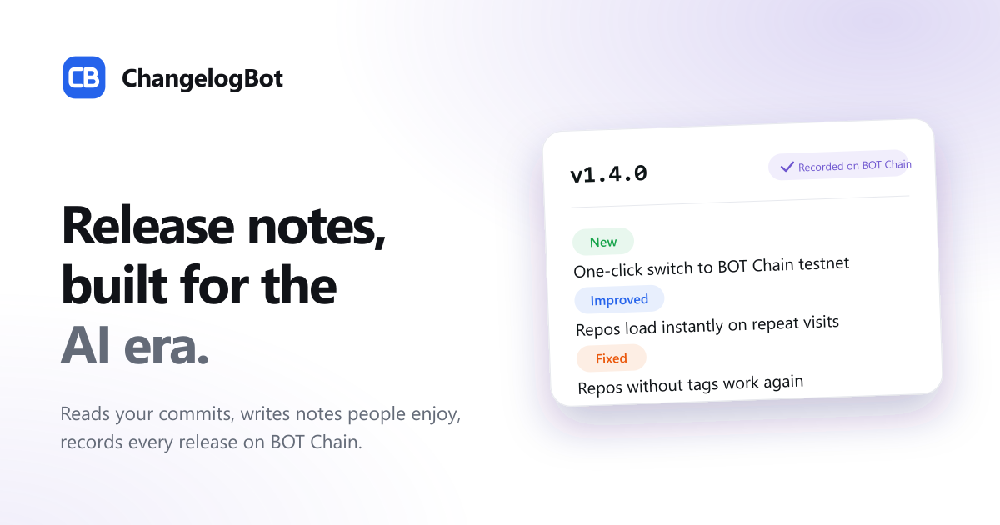

<p align="center">
  
</p>

<h1 align="center">ChangelogBot</h1>

<p align="center">
  <strong>Release notes, built for the AI era.</strong><br />
  Pick two versions. ChangelogBot reads your commits, writes release notes people enjoy reading,<br />
  and records every release on <a href="https://botchain.ai">BOT Chain</a>.
</p>

<p align="center">
  <a href="#features">Features</a> ·
  <a href="#how-it-works">How it works</a> ·
  <a href="#run-locally">Run locally</a> ·
  <a href="#smart-contract">Smart contract</a> ·
  <a href="#deploy">Deploy</a>
</p>

<p align="center">
  
</p>

---

## Why

Release notes are the part of shipping everyone skips. Commit logs are written for developers (`fix: null check in parser`), not for the people using your product. And once notes are published, nothing stops them from being quietly edited later.

ChangelogBot turns a commit range into notes a user can read in 30 seconds, gives you every format you need to announce it, and anchors each release on-chain so its history can't be rewritten.

## Features

- **Repo → notes in one minute.** Paste any public GitHub repo, pick a range (tag → tag, tag → latest commit, or dates), and get grouped notes: ✨ New · 🛠 Improved · 🐛 Fixed · ⚠️ Breaking.
- **Conventional Commits first, AI for the rest.** `feat:`, `fix:`, `perf:` and `!`/`BREAKING` are classified deterministically; Gemini only rewrites the remaining commits — and is told never to invent changes that aren't in the commit or PR text.
- **Noise filter.** Merge commits, `chore:`, `ci:`, dependency bumps and bot commits are filtered out by default (one toggle to include them).
- **Live stats.** Commits, pull requests and contributors in the range, plus your remaining GitHub API quota.
- **A real editor.** Drag notes between groups, edit text inline, hide internal items, write a two-line summary and up to three highlights (with an optional image/GIF), and switch tone: Friendly · Professional · Playful.
- **Semver suggestion.** Breaking → major, any New → minor, only fixes → patch.
- **Four outputs from one draft:**
  - a public changelog page at `/c/owner/repo` — a version timeline, newest first
  - GitHub Release Markdown — copy it, or create the release in one click when signed in with GitHub
  - an X post (≤ 280 characters) and a thread version, optionally rewritten by AI
  - a plain-text email summary for your newsletter
- **Recorded on BOT Chain.** Notes JSON goes to IPFS; repo, version, commit range, notes hash and CID are recorded by the `ChangelogBot` contract. The public page shows **✓ Recorded on BOT Chain** with an explorer link per release, and verifies the IPFS notes against the on-chain hash.
- **Verified maintainer.** Add a `.changelogbot` file containing your wallet address to the repo, *or* sign in with GitHub as someone with push access. Unverified releases are clearly labelled.
- **Sign in with GitHub (optional).** Raises the GitHub API limit from 60 to 5,000 requests/hour, enables verification by push access, and creates GitHub Releases directly.
- **Responsive.** Three panes on desktop (range · editor · outputs), a bottom sheet for outputs on tablets and phones.

## How it works

```
GitHub repo ──► range (tags / dates / latest) ──► commits + PRs
                                                      │
                     noise filter ◄───────────────────┘
                          │
        Conventional Commits ──► classified items
                          │
                  remaining commits ──► Gemini (/api/changelog/draft) ──► user-friendly items
                          │
                       editor  (drag · edit · hide · tone · highlights)
                          │
       ┌──────────────────┼──────────────────┬───────────────┐
  changelog page     GitHub Release        X post         email
                          │
             notes JSON ──► IPFS (Pinata)
                          │
             ChangelogBot.publish(repo, version, from, to, notesHash, cid, verified)
                          │
                    BOT Chain mainnet (677)
```

1. **Repo** — `github.com/owner/repo` loads tags, releases and branches.
2. **Range** — From (tag / date) → To (latest / tag / date) on any branch, plus the new version name.
3. **Read changes** — up to 250 commits per range; larger ranges ask you to split.
4. **Draft** — grouped items with links to their commits/PRs, a summary and highlights.
5. **Edit** — everything stays editable until you publish.
6. **Outputs** — copy or open each format.
7. **Publish** — connect MetaMask (auto-switches to BOT Chain), upload to IPFS, sign one transaction.

## Tech stack

| Layer | Tools |
| --- | --- |
| App | Next.js 16 (App Router), React 19, TypeScript, Tailwind CSS 4 |
| Motion & UI | GSAP, dnd-kit |
| AI | AI SDK + Google Gemini (`gemini-flash-latest` by default) |
| Web3 | wagmi, viem, MetaMask |
| Storage | IPFS via Pinata |
| Chain | BOT Chain — mainnet `677`, testnet `968` |
| Contract | Solidity 0.8.24 (`evmVersion: paris`), Hardhat tests, deployed with Remix |
| Tests | Vitest |

## Run locally

Requires Node.js 22+.

```bash
npm install
cp .env.example .env.local   # fill in the keys below
npm run dev                  # http://localhost:3000
```

### Environment variables

| Variable | Required | What it is |
| --- | --- | --- |
| `GOOGLE_GENERATIVE_AI_API_KEY` | yes | Free Gemini key from [Google AI Studio](https://aistudio.google.com/apikey) |
| `AI_MODEL` | no | Gemini model id, defaults to `gemini-flash-latest` |
| `PINATA_JWT` | yes (to publish) | Pinata JWT for IPFS uploads |
| `PINATA_GATEWAY` | no | Dedicated gateway, e.g. `your-name.mypinata.cloud` |
| `GITHUB_CLIENT_ID` / `GITHUB_CLIENT_SECRET` | no | GitHub OAuth App for sign-in. Callback: `<site>/api/auth/github/callback` |
| `GITHUB_SESSION_SECRET` | with GitHub sign-in | Long random string that encrypts the session cookie (`openssl rand -base64 32`) |
| `NEXT_PUBLIC_CONTRACT_ADDRESS` | yes (to publish) | Deployed `ChangelogBot` address |
| `NEXT_PUBLIC_NETWORK` | no | `testnet` for chain 968; empty for mainnet (677) |
| `NEXT_PUBLIC_SITE_URL` | no | Public URL, used for links and share text |
| `ALLOWED_ORIGINS` | no | Extra origins allowed to call `/api/*` (comma separated) |

Drafting and copying work without a wallet; only publishing needs MetaMask and the contract address.

**Security:** never commit `.env.local`. All keys stay server-side in API routes. API routes check the origin, rate-limit, cap body size and validate input with zod; request bodies are never logged. Release notes are rendered as React elements, never as HTML.

### Scripts

```bash
npm run dev         # dev server
npm run build       # production build
npm run lint        # ESLint
npm run typecheck   # tsc --noEmit
npm test            # unit tests: grouping, noise filter, semver, outputs, hashing, GitHub client
```

## Smart contract

`contracts/src/ChangelogBot.sol` — an append-only registry of releases. No tokens, no payments, no admin.

- `publish(repo, version, fromCommit, toCommit, notesHash, cid, verified)` → release id
- A version can't be published twice for the same repo by the same publisher; version ≤ 20 characters
- Views: `getRelease(id)`, `releasesFor(repo)`, `latestFor(repo)`, `releasesBy(address)`, `total()`
- Event: `Published(id, repo, version, publisher, verified)`

| Network | Chain ID | RPC | Explorer |
| --- | --- | --- | --- |
| BOT Chain mainnet | 677 | `https://rpc.botchain.ai` | [scan.botchain.ai](https://scan.botchain.ai) |
| BOT Chain testnet | 968 | `https://rpc.bohr.life` | [scan.bohr.life](https://scan.bohr.life) |

**Mainnet contract:** `TBD — set after the Remix deploy`

```bash
cd contracts && npm install && npm test   # contract tests
```

Deployment steps (Remix, testnet first, then mainnet): see [`contracts/README.md`](contracts/README.md).

### Verified maintainer file

Commit a file named `.changelogbot` to the default branch of your repo:

```
# Put your wallet address here (one line) to get the Verified maintainer badge.
0xYourWalletAddressHere
```

## Deploy

1. Deploy the contract (see above) and set `NEXT_PUBLIC_CONTRACT_ADDRESS`.
2. Import the repo in [Vercel](https://vercel.com/new), add the environment variables, deploy.
3. Set `NEXT_PUBLIC_SITE_URL` to your domain. If you use GitHub sign-in, update the OAuth callback URL to match.

## Project structure

```
contracts/          Solidity contract + Hardhat tests (deployed via Remix)
public/             logo, brand assets
src/app/            routing only: /, /app, /c/[owner]/[repo], /api/*
src/features/       marketing site, composer (the /app editor), changelog page, wallet, GitHub auth
src/components/ui/  shared UI pieces
src/lib/            pure logic: GitHub client, Conventional Commits, noise filter, semver, outputs, hashing
src/server/         server-only: AI, IPFS, GitHub session, rate limiting, chain reads
src/web3/           chains, ABI, wagmi config, contract reads
src/config/         site + contract configuration
```

---

<p align="center">
  Built on <a href="https://botchain.ai">BOT Chain</a> · AI-drafted notes — always review before publishing.
</p>
